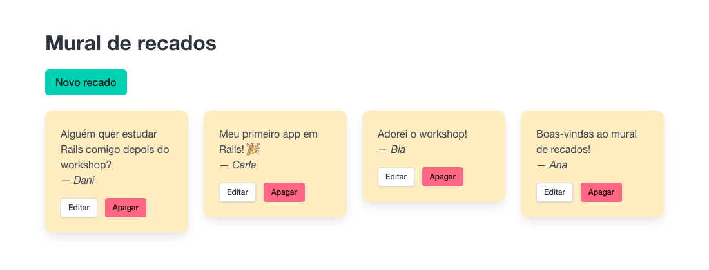

# Mural de recados

Um mural de recados na web: qualquer pessoa pode deixar um recado, que aparece como um post-it colado na parede. Dá para postar, ver, corrigir e apagar recados.



Este é o app de referência do projeto **Mural de recados** do [guia do Rails Girls SP](https://guia.railsgirls.com.br/projetos/mural-de-recados/). Ele mostra como o app fica ao seguir o guia capítulo por capítulo, e serve de apoio para a mentoria e para quem quiser comparar com o próprio código.

Quer construir o seu? Comece pelo [guia](https://guia.railsgirls.com.br/projetos/mural-de-recados/), não por este repositório. 💜

## Um commit por capítulo

O histórico segue os capítulos do guia, na ordem. Para ver como o app estava no fim de um capítulo, abra o commit correspondente.

| Capítulo do guia | Commit |
|---|---|
| [01. Por onde começar?](https://guia.railsgirls.com.br/projetos/mural-de-recados/01-por-onde-comecar/) | `Cria o app Mural de recados` |
| [02. Como guardar os recados?](https://guia.railsgirls.com.br/projetos/mural-de-recados/02-como-guardar-os-recados/) | `Cria o model Message` |
| [03. Como ver todos os recados?](https://guia.railsgirls.com.br/projetos/mural-de-recados/03-ver-todos-os-recados/) | `Mostra os recados no mural` |
| [04. Como postar um recado?](https://guia.railsgirls.com.br/projetos/mural-de-recados/04-postar-um-recado/) | `Posta recados pelo formulário` |
| [05. Errei! Como corrigir ou apagar?](https://guia.railsgirls.com.br/projetos/mural-de-recados/05-corrigir-ou-apagar/) | `Corrige e apaga recados` |
| [06. Como deixar o mural de recados mais bonito?](https://guia.railsgirls.com.br/projetos/mural-de-recados/06-como-deixar-o-mural-mais-bonito/) | `Deixa os recados com cara de post-it` |
| [07. E se alguém mandar um recado vazio?](https://guia.railsgirls.com.br/projetos/mural-de-recados/07-e-se-o-recado-vier-vazio/) | `Valida os recados e mostra os aviso` |
| [08. Como mostrar o mural de recados para o mundo?](https://guia.railsgirls.com.br/projetos/mural-de-recados/08-como-mostrar-o-mural-para-o-mundo/) | `Prepara o app para o Render` e `Muda o título do mural` |

## Além do guia

Os commits depois do capítulo 08 não fazem parte do workshop. São ajustes para o mural de recados que o Rails Girls SP usa no evento:

- **Mural fechado para edição e modo admin:** com as variáveis `READ_ONLY` e `ADMIN_PASSWORD`, o mural fica só para leitura, e só quem entra em `/admin` pode postar, corrigir e apagar (veja [Variáveis de ambiente](#variáveis-de-ambiente)).
- **Links clicáveis:** endereços que começam com `http://` ou `https://` dentro de um recado viram links, que abrem em outra aba.
- **Testes automatizados:** o guia deixa os testes de fora, para caber no tempo do workshop. Aqui eles cobrem o modo admin e os links.

## Como rodar

O jeito mais fácil é abrir o repositório num **GitHub Codespace**: ele já vem com o Ruby e o Rails instalados. Para instalar no seu computador, veja [Instalando no seu computador](https://guia.railsgirls.com.br/extras/no-seu-computador.html), no guia.

No terminal:

```
bundle install
bin/rails db:prepare
bin/rails server
```

E abra [http://localhost:3000](http://localhost:3000).

Para rodar os testes:

```
bin/rails test
```

O app usa Ruby 4.0.6 e Rails 8.1. Em desenvolvimento, o banco de dados é SQLite; no ar, PostgreSQL.

## Variáveis de ambiente

Todas são opcionais. Sem nenhuma delas, o mural de recados fica aberto e qualquer pessoa pode postar, corrigir e apagar recados.

| Variável | O que faz |
|---|---|
| `ACCESS_PASSWORD` | Pede o usuário `mural` e essa palavra-chave antes de abrir qualquer página. |
| `READ_ONLY` | Com qualquer valor, como `true`, o mural fica só para leitura: os botões de postar, corrigir e apagar somem. Para reabrir, remova a variável (`READ_ONLY=false` também fecha). |
| `ADMIN_PASSWORD` | A senha do login em `/admin`, que libera a edição mesmo com o mural fechado. Sem ela, ninguém entra como admin. |

No Render, as variáveis ficam em **Environment**, na página do app. Ao mudar uma delas, o Render reinicia o app sozinho.

## Como colocar no ar

O app roda no [Render](https://render.com), no plano gratuito, com um banco de dados PostgreSQL. O passo a passo está no capítulo [08. Como mostrar o mural de recados para o mundo?](https://guia.railsgirls.com.br/projetos/mural-de-recados/08-como-mostrar-o-mural-para-o-mundo/mao-na-massa.html) do guia.
